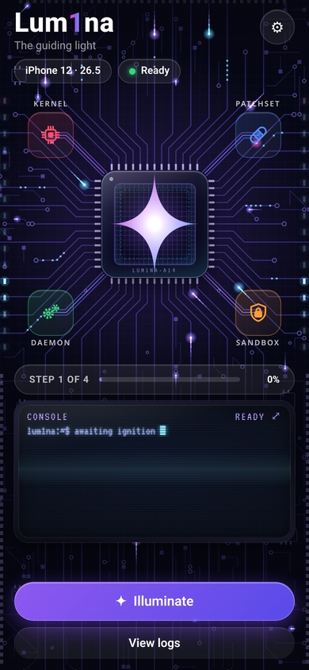
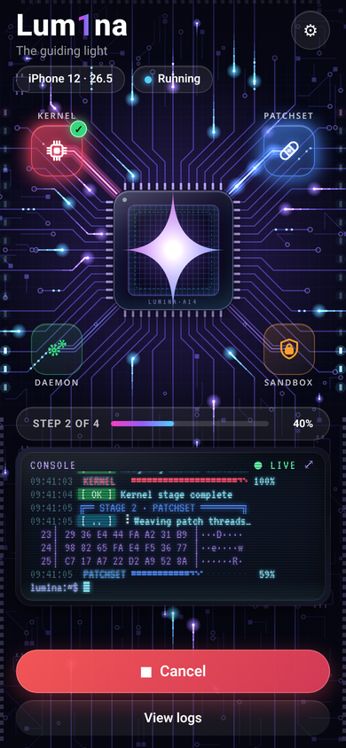
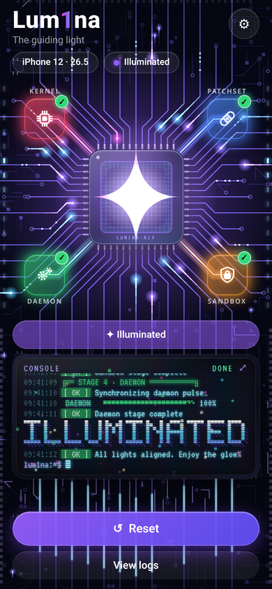
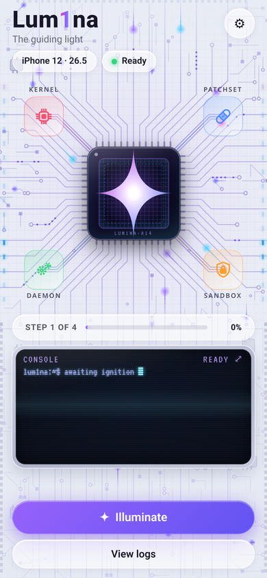
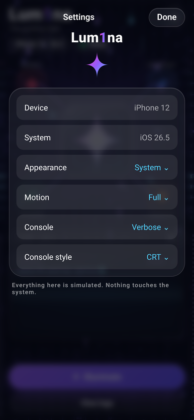
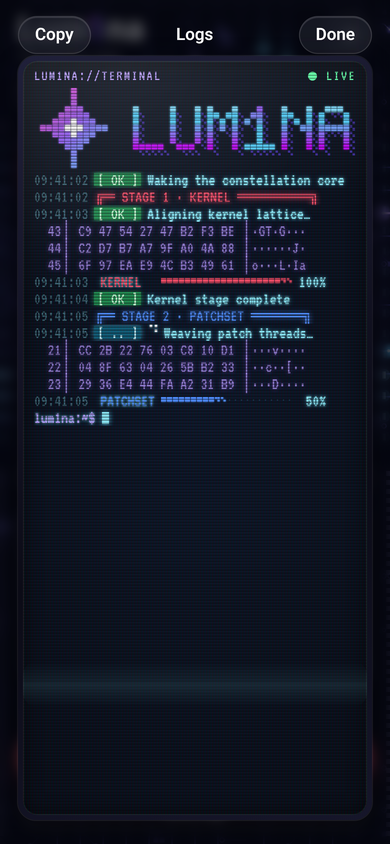
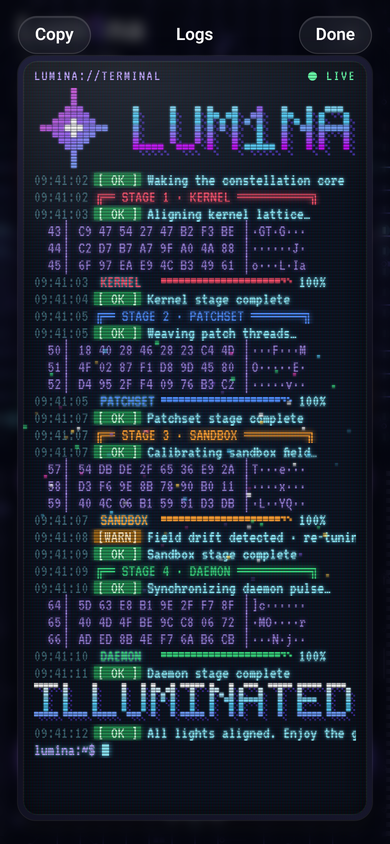

# Lum1na — UI demo (purely cosmetic)

**Lum1na** (wordmark **LUM1NA**, tagline *"The guiding light"*) is a polished SwiftUI
concept app with a glowing circuit‑board, Liquid‑Glass aesthetic: the brand's
four‑point star logo sits on a microchip as its die, and energy flows along the traces.

> ⚠️ **This is a 100% cosmetic, dummy UI.** It contains **no exploit, no
> system‑modification, and no privileged code of any kind.** Every "stage", log
> line and progress value is *simulated with timers only*. The theatrical labels
> (Kernel / Patchset / Sandbox / Daemon, "Illuminated.") are decorative and do
> nothing. The app only animates, logs fake lines, and shows a success state.

## Screenshots

These are rendered from the HTML/CSS/JS preview in [`preview/`](preview/) (an exact
visual replica of the SwiftUI layout). The real app uses native iOS 26 Liquid Glass.

| Dark · idle | Dark · running | Dark · success |
|---|---|---|
|  |  |  |

| Light · idle | Settings sheet |
|---|---|
|  |  |

| CRT console | CRT success |
|---|---|
|  |  |

A short screen recording of the full simulated run is produced at
`preview/renders/lumina-run.mp4` (not committed — see `.gitignore`).

## Features

- **Circuit-board hero.** A seeded, procedurally generated PCB (`BoardLayout`): chip
  fan-out traces radiating to the edges with 45° bends, triple-line buses to four
  coloured glass stage pads (cpu / bandage / lock.shield / gearshape.2), IC footprints,
  vias, pads, connector fingers and edge LED columns. The vector `LuminaStar` glows on
  a glassy microchip as its die.
- **Energy animation** (`TimelineView` + `Canvas`, precomputed paths): comet pulses
  travel toward the chip, data bits flicker, LEDs chase. During a run the active bus
  lights in its stage colour with fast node→chip pulses, finished buses stay lit, the
  star brightens per stage; on success a radial surge races out along every trace, the
  star flares and a success haptic fires. Motion Full / Subtle / Off and Reduce Motion
  (static lit board with crossfades) are honoured.
- **Retro CRT console** (`CRTTerminalView`): VT323 pixel font, phosphor glow,
  scanlines, RGB aperture mask, vignette, curved glass, flicker, rolling refresh bar,
  blinking block cursor. A pixel-block LUM1NA banner with a pixel star, box-drawing
  stage headers, braille spinners, glitch-then-resolve lines, coloured `[ OK ]`
  `[ .. ]` `[WARN]` chips, scrolling hex blocks, dithered `░▒▓█` meters and an
  ILLUMINATED banner with pixel confetti. Console style **CRT / Clean** in Settings.
- A simulated 4‑stage run (~10 s) driven by a `@MainActor @Observable` model with
  async timers; Illuminate / Cancel / Reset; progress capsule morphs into the success state.
- Light **and** dark modes, Reduce Motion / Reduce Transparency / Dynamic Type /
  VoiceOver support, 44 pt hit targets, and `#Preview`s.

The VT323 font (`Lum1naUI/Resources/Fonts`) is SIL Open Font License 1.1 and is
registered at runtime with Core Text, so no Info.plist entry is needed.

## Requirements / building

- Xcode 26+ with the **iOS 26 SDK**, deployment target **iOS 26.0**, Swift 6.
- Open `Lum1naUI.xcodeproj`, select the **Lum1naUI** scheme, run on an iOS 26 simulator
  or device.

CI: `.github/workflows/build.yml` builds the app unsigned on a macOS runner and packages
an unsigned `Lum1na-Dummy.ipa` (uploaded as an artifact along with the full xcodebuild log).

## Liquid Glass APIs used

`glassEffect(_:in:)`, `Glass.regular` / `.clear` / `.tint()` / `.interactive()`,
`GlassEffectContainer(spacing:)`, `glassEffectID(_:in:)`, `glassEffectTransition(.matchedGeometry)`,
`.buttonStyle(.glass)` / `.glassProminent`. The chip is content, so it uses a glass
gradient plus a pure‑SwiftUI Fresnel rim (no Metal) rather than Liquid Glass.

## Project layout

```
Lum1naUI/
  App/        App entry + root (appearance/motion wiring, font registration)
  Models/     RunPhase, RunStage, LogEntry/LogKind/LogTag, LuminaRunModel (simulation),
              PixelFont, PixelArtwork, HexDump, BoardSnapshot, SeededGenerator, settings enums
  Theme/      Palette, Motion presets, FresnelRim, GlassSurface, Wordmark, TerminalFont
  Resources/  Fonts/VT323-Regular.ttf (+ OFL)
  Views/
    Background/  BoardLayout (generator), BoardTrace, OccupancyGrid, BoardColors,
                 BoardStaticLayer, BoardEnergyLayer, CircuitBoardView
    Hero/        HeroLayout, CircuitHeroView, MicrochipView, ChipDieView, StageNodeView
    Star/        LuminaStarShape, StarCoreView
    Console/     CRTTerminalView, CRTOverlayView, ConsoleCardView, ConsoleLogView,
                 ConsoleRowView, PixelArtView, StageMeterView, TagChipView,
                 ScrambleText, BlinkingCursor, PixelConfettiView
    Home/        header, chips, progress capsule, buttons, HomeView
    Sheets/      settings sheet, console sheet
  Assets.xcassets  LuminaLogo (light=filled / dark=outline), AppIcon, AccentColor
```

Preview renders: `cd preview && npm i && node shots.js && node capture.js && node video.js`.
